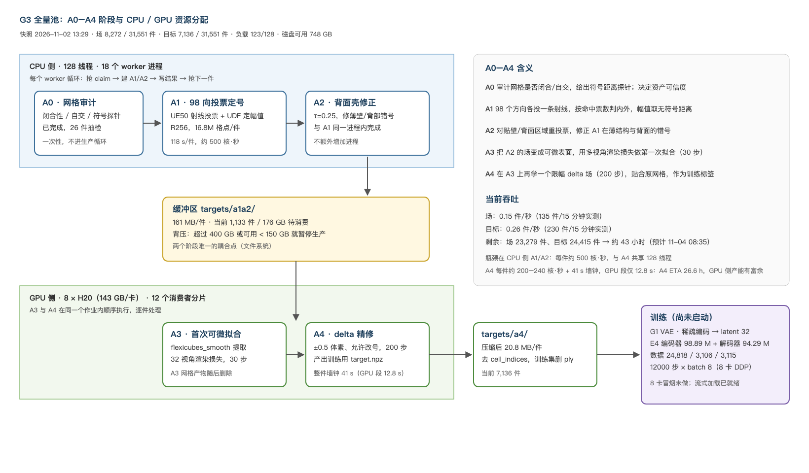

# G3 全量池：阶段划分与当前资源分配

> 快照时间：2026-11-02 13:29（目标生成进行中，训练尚未启动）
> 数字来源：`/data/hi3d/g3/exp-35k-r256-e4-v1` 实测，经 `remote_g3_status`（含 3 次 × 4 s 的 `nvidia-smi`／`/proc/loadavg` 均值）与 `logs/stream.log` 最后一行为准；速率取 15 分钟窗口。

## 一、数据流水线（A0 → A4 → 训练）

源网格池：34,847 文件 / 121 GB（obj/glb/gltf/stl/ply + Blender 转好的 fbx/blend/dae）。

## 二、当前 CPU / GPU 任务分配

| 资源 | 占用者 | 数量 | 单件成本 | 说明 |
|---|---|---|---|---|
| **CPU（128 线程）** | A1 + A2 worker | **18 个进程** | 118 s 墙钟 ≈ **500 核·秒** | 每进程内循环：抢 claim → 建 A1/A2 → 写结果 → 再抢下一件 |
| CPU（少量） | A4 消费者进程 | 12 | ≈200–240 核·秒 | 读 161 MB 缓存、网格加载、A3/A4 布置、指标计算 |
| CPU（少量） | 压缩守护 | 1 | 每 120 s 一轮 | 去 `cell_indices`、删训练集 ply |
| **GPU（8×H20-143GB）** | A3 + A4 | 12 个分片 | 41 s 墙钟（GPU 段 12.8 s） | A3 与 A4 在**同一个作业**里顺序执行 |

当前实测（13:29）：

| 指标 | 数值 |
|---|---|
| 负载 | **122.7 / 128**（5 分钟均值 145；瞬时 GPU 均值约 65%，4 秒 3 次采样均值 35.4%——A4 每件大部分墙钟不在 GPU 段） |
| 速率 | 场 **0.15 件/秒**（9 件/分）、目标 **0.26 件/秒**（15.3 件/分） |
| 完成量 | 场 8,272 / 31,551（26.2%）、目标 7,136 / 31,551（22.6%） |
| 积压 | 1,133 件 / 176 GB（预算 400 GB，未触发 `pause`；`free_gb` 748.5） |
| 磁盘 | 可用 **748 GB**，`targets` 已占 367 GB |
| 剩余 ETA | 场 43.1 h（唯一瓶颈）→ 目标 26.6 h → 整体 **约 43 h，预计 11-04 08:35 完成** |

注：A1/A2 现在比 A4 慢（43.1 h vs 26.6 h），GPU 侧产能有富余；要缩短总时长只能想办法让出 CPU 给 A1/A2，而不是继续加 A4 分片。

## 三、A0–A4 含义速查

| 阶段 | 一句话 | 跑在哪 | 产物 |
|---|---|---|---|
| **A0** | 网格可信度审计（是否闭合、有无自交）＋符号距离探针 | CPU | 审计记录 |
| **A1** | 用 98 个方向的射线投票判断每格在实体内外，幅值取无符号距离 | CPU | 初始场 |
| **A2** | 针对薄壁/背面误判做「背面壳」修正 | CPU | 修正后的初始场 |
| **A3** | 第一次可微拟合：把 A2 的场变成可微表面，用多视角渲染损失优化 30 步 | GPU | A3 网格（随后删除） |
| **A4** | 在 A3 上加一个限幅 delta 场，再优化 200 步贴合原网格 | GPU | **训练用 `target.npz`** |

## 四、训练现状

| 项目 | 现状 |
|---|---|
| **数据集** | 31,551 件可用；容量策略排除 512 件 → **训练 24,818 / 验证 3,106 / 测试 3,115**（按面数 5 分位分层、层内 80/10/10） |
| 分辨率 | R256（体素边长 1/128 归一化单位） |
| **网络结构** | 编码器 **E4**：4 级宽度 192/384/768/1536、每级 2 block → **98.89 M**；解码器沿用 Hi3D 释放权重 **94.29 M**（`conv_out` 冻结不用）；合计 **193.18 M**，latent 32 维 |
| 单件目标 | `target.npz` = coords / features(4ch) / cells / field / delta，最细级 cell 数决定显存（≈27 kB/cell） |
| **训练流程** | 每步取 1 件：稀疏编码 → latent 32 → 解码器输出 fine voxel 上的 signed 场、delta、support 占用 → loss = 场（带近表面加权）+ delta + support + validity → AdamW，12000 步 × batch 8（8 卡各 1 件） |
| 已就绪 | 流式加载（`--targets-root`，按步读盘，含 `cell_indices` 重建）、DDP 训练器、A4-only 汇总器 |
| **未完成** | ① 8 卡 DDP 冒烟（200 步，验证 NCCL/每 rank 峰值/续训）；② 目标全量生成后出正式 summary；③ 训练 + 评测（与 g2 的 R256 基线 3.943e-4 / 4.736e-4 对照） |
| 训练预算 | E4 臂 12000 步约 8–15 h（取决于大件占比，首步有 455 s 预热）；随后 E0 对照臂 6–16 h |

**一句话总结**：CPU 在跑 A1/A2（18 个 worker，占绝大部分算力，也是当前唯一瓶颈），GPU 在跑 A3/A4（每件 30+200 步拟合，产能有富余），两侧通过 `targets/a1a2/` 缓冲区和 400 GB 字节预算解耦；目标侧 22.6% 完成、整体预计 11-04 08:35 跑完，训练侧代码已就绪，冒烟可随时启动。另注：A1/A2 目前累计 64 件失败（`assets/` 结果里 failed 计数），需在目标生成收尾时确认是重试还是按不可用排除。